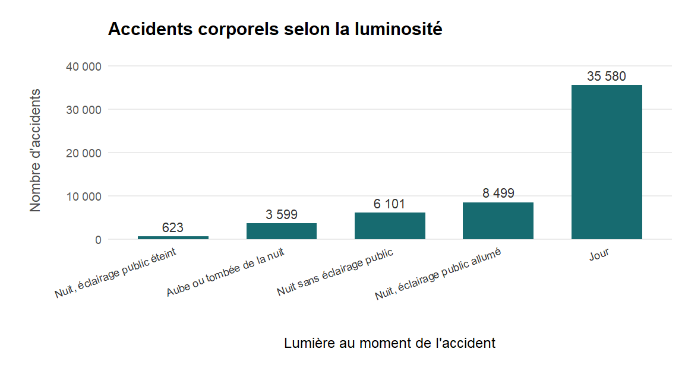

# Partie 1 – Lisibilité des visualisations

## Règle 7 – Étiquettes et graduations lisibles

**Quel est le problème ?**

Dans le premier graphique, les étiquettes de l'axe horizontal se chevauchent. Il devient donc difficile de lire les différentes catégories.

**Comment corriger le problème ?**

Il faut améliorer la lisibilité des étiquettes en les espaçant, en réduisant leur nombre ou en adaptant leur orientation.

**Application à mes propres graphiques :**

Dans mes graphiques, je dois faire attention à la taille des textes et à l'espacement des étiquettes pour éviter qu'elles se chevauchent.

---

## Règle 8 – Accessibilité des couleurs

**Quel est le problème ?**

Dans le premier graphique, les catégories sont différenciées uniquement par les couleurs. Certaines personnes peuvent avoir des difficultés à distinguer les différentes parties du graphique.

**Comment corriger le problème ?**

Il faut utiliser des couleurs faciles à distinguer et ajouter des étiquettes ou des motifs pour identifier les catégories sans dépendre uniquement des couleurs.

**Application à mes propres graphiques :**

Je dois choisir des couleurs suffisamment différentes et ajouter des indications pour que les informations restent compréhensibles par tout le monde.

---

## Règle 9 – Étiquetage direct

**Quel est le problème ?**

Dans le premier graphique, il faut regarder la légende pour savoir à quelle courbe correspond chaque catégorie. Cela oblige à faire des allers-retours avec les yeux.

**Comment corriger le problème ?**

Il est préférable de placer directement les noms des catégories à côté des courbes, notamment lorsqu'il y en a peu.

**Application à mes propres graphiques :**

Lorsque je réalise un graphique avec plusieurs courbes, je peux directement écrire le nom de chaque série à côté de celle-ci pour faciliter la lecture.

---

## Règle 10 – Éviter le chartjunk

**Quel est le problème ?**

Dans le premier graphique, il y a trop de lignes de grille. Cela surcharge la visualisation et détourne l'attention des données.

**Comment corriger le problème ?**

Il faut supprimer les éléments inutiles et conserver uniquement les lignes qui aident à lire les valeurs. Le graphique doit rester simple.

**Application à mes propres graphiques :**

Je dois éviter de mettre trop de décorations, de couleurs ou de lignes dans mes graphiques. Je privilégie une présentation simple pour que les données soient plus visibles.

---

## Règle 11 – Trop de catégories

**Quel est le problème ?**

Dans le premier graphique, il y a trop de catégories à comparer. Il devient difficile de repérer les informations importantes.

**Comment corriger le problème ?**

Il faut réduire le nombre de catégories affichées, garder les plus importantes ou regrouper certaines catégories pour rendre le graphique plus facile à lire.

**Application à mes propres graphiques :**

Lorsque j'ai beaucoup de catégories, je peux afficher uniquement les principales, par exemple les dix catégories les plus représentées, afin de faciliter la comparaison.

---

## Règle 12 – Trier les barres catégorielles

**Quel est le problème ?**

Dans le premier graphique, les barres ne sont pas classées. Il est donc moins facile de comparer les valeurs et de repérer les plus importantes.

**Comment corriger le problème ?**

Il faut classer les barres par ordre décroissant ou croissant selon les valeurs, sauf lorsqu'il existe déjà un ordre logique entre les catégories.

**Application à mes propres graphiques :**

Dans mes graphiques en barres, je peux classer les catégories de la valeur la plus élevée à la plus faible pour identifier rapidement les résultats les plus importants.

---

## Règle 13 – Surimpression dans les nuages de points

**Quel est le problème ?**

Dans le premier graphique, plusieurs points se superposent. On ne sait donc pas toujours combien d'observations se trouvent au même endroit.

**Comment corriger le problème ?**

Il est possible d'utiliser la transparence des points (`alpha`), le décalage des points (`jitter`) ou encore des bulles de tailles différentes pour représenter le nombre d'observations superposées.

**Application à mes propres graphiques :**

Lorsque je représente beaucoup de données dans un nuage de points, je peux utiliser la transparence pour mieux distinguer les observations et repérer les zones où elles sont nombreuses.

---

## Règle 14 – Précision décimale

**Quel est le problème ?**

Dans le premier graphique, les valeurs affichent trop de chiffres après la virgule. Cela rend les graduations moins faciles à lire.

**Comment corriger le problème ?**

Il faut arrondir les valeurs et conserver uniquement le nombre de décimales nécessaires. Dans la plupart des cas, deux décimales suffisent.

**Application à mes propres graphiques :**

Je peux limiter les décimales à deux chiffres après la virgule lorsque je représente des moyennes ou des pourcentages. Cela rend les valeurs plus faciles à comprendre.

---

## Règle 15 – Formatage des dates

**Quel est le problème ?**

Dans le premier graphique, les dates sont trop nombreuses et se chevauchent sur l'axe horizontal. Il devient difficile de les lire.

**Comment corriger le problème ?**

Il faut réduire le nombre de dates affichées et utiliser un format plus court. Par exemple, afficher uniquement le jour ou le mois selon la période étudiée.

**Application à mes propres graphiques :**

Lorsque je représente une évolution dans le temps, je peux afficher moins de dates sur l'axe horizontal et utiliser un format plus court pour éviter les chevauchements.

---

## Règle 16 – Économie visuelle

**Quel est le problème ?**

Dans le premier graphique, il y a trop de barres à afficher. Cela rend la comparaison difficile et donne trop d'informations au lecteur en même temps.

**Comment corriger le problème ?**

Il faut simplifier le graphique en conservant uniquement les informations les plus importantes. On peut, par exemple, afficher les principales catégories plutôt que toutes les données.

**Application à mes propres graphiques :**

Je dois éviter de vouloir tout afficher dans un seul graphique. Je peux sélectionner les informations les plus utiles et créer plusieurs graphiques si nécessaire pour faciliter la compréhension.

# Partie 2 – Analyse et interprétation des visualisations

## 1. Répartition géographique des accidents corporels en 2024

### Visualisation : Carte de France

### Analyse

Cette carte représente la localisation des accidents corporels enregistrés en France métropolitaine en 2024.

Les cercles représentent le nombre d'accidents regroupés dans différentes zones géographiques. Plus un cercle est grand, plus le nombre d'accidents dans la zone concernée est élevé.

On observe une concentration importante d'accidents autour de Paris et dans plusieurs grandes agglomérations. D'autres concentrations sont également visibles dans le sud-est de la France.

À l'inverse, certaines zones présentent des cercles plus petits, indiquant un nombre d'accidents moins important.

### Interprétation

La répartition des accidents corporels est inégale sur le territoire français. Certaines zones géographiques concentrent davantage d'accidents, notamment autour des grandes agglomérations.

Cette concentration peut notamment être liée à la densité de population et à l'importance de la circulation routière dans ces secteurs.

### Règles de lisibilité appliquées

- **Règle 7 – Étiquettes et graduations lisibles :** le titre de la carte est clairement visible. Les éléments inutiles des axes ont été supprimés pour faciliter la lecture.
- **Règle 10 – Éviter le chartjunk :** les éléments décoratifs inutiles ont été supprimés. Le fond reste simple pour mettre en évidence les accidents.
- **Règle 13 – Surimpression dans les nuages de points :** la transparence des cercles (`alpha`) permet de mieux visualiser les zones où les observations se superposent. La taille des cercles représente également le nombre d'accidents regroupés.
- **Règle 16 – Économie visuelle :** les accidents sont regroupés par zones géographiques afin de rendre la carte plus lisible.

---

## 2. Répartition des accidents selon la luminosité

### Visualisation : Histogramme

### Analyse

Ce graphique présente le nombre d'accidents corporels enregistrés en 2024 selon les conditions de luminosité au moment de l'accident.

Les résultats obtenus sont les suivants :

| Conditions de luminosité | Nombre d'accidents |
|---|---:|
| Jour | 35 580 |
| Nuit, éclairage public allumé | 8 499 |
| Nuit sans éclairage public | 6 101 |
| Aube ou tombée de la nuit | 3 599 |
| Nuit, éclairage public éteint | 623 |

La catégorie « Jour » arrive largement en tête avec 35 580 accidents. Elle représente environ 65,4 % des accidents recensés.

Les accidents survenant la nuit avec un éclairage public allumé arrivent en deuxième position, avec 8 499 accidents.

La catégorie « Nuit, éclairage public éteint » présente le nombre d'accidents le plus faible, avec 623 accidents.

### Interprétation

On constate que la majorité des accidents corporels enregistrés ont lieu pendant la journée. Cette différence peut notamment s'expliquer par une circulation routière plus importante durant cette période.

On observe également davantage d'accidents la nuit lorsque l'éclairage public est allumé que lorsqu'il est éteint. Cela peut être lié à une circulation plus importante dans les zones urbaines éclairées.

Cependant, ces résultats représentent uniquement le nombre d'accidents enregistrés. Ils ne permettent pas de déterminer à eux seuls les conditions dans lesquelles le risque d'accident est le plus élevé.

### Règles de lisibilité appliquées

- **Règle 7 – Étiquettes et graduations lisibles :** les étiquettes des catégories ont été inclinées afin d'éviter qu'elles se chevauchent.
- **Règle 8 – Accessibilité des couleurs :** les catégories sont identifiées par des intitulés explicites et les valeurs sont affichées au-dessus des barres. La lecture ne dépend donc pas uniquement de la couleur.
- **Règle 10 – Éviter le chartjunk :** les lignes de grille verticales et les éléments décoratifs inutiles ont été supprimés pour alléger le graphique.
- **Règle 12 – Trier les barres catégorielles :** les catégories sont classées par ordre croissant du nombre d'accidents afin de faciliter la comparaison.
- **Règle 14 – Précision décimale :** les nombres sont affichés sans décimales, car il s'agit de nombres entiers d'accidents.
- **Règle 16 – Économie visuelle :** le graphique présente cinq catégories clairement identifiées, sans ajouter d'informations inutiles.

---

## 3. Bilan des analyses

Les deux visualisations permettent d'étudier les accidents corporels de 2024 sous deux angles complémentaires.

La carte met en évidence les différences de répartition géographique des accidents sur le territoire français. Elle montre notamment une concentration plus importante dans certaines grandes agglomérations.

L'histogramme permet de comparer les accidents selon les conditions de luminosité. Il montre que la majorité des accidents enregistrés ont eu lieu pendant la journée.

Les choix de représentation et les règles de lisibilité appliquées permettent de présenter les résultats de manière claire et de faciliter leur compréhension.
